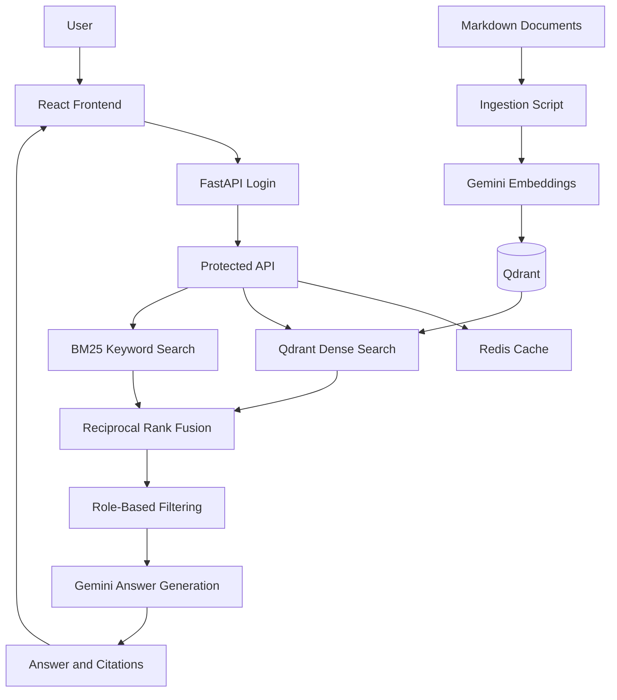

# Meridian Engineering Copilot

An AI-powered engineering knowledge assistant built with Retrieval-Augmented Generation (RAG), hybrid search, and role-based access control.

Meridian Engineering Copilot helps engineering teams retrieve answers from technical documentation using semantic search, keyword retrieval, and Google Gemini. Answers include source citations, with abstention when retrieval falls below a configured threshold.

## Features

### AI and Retrieval
- RAG pipeline for engineering documentation
- Google Gemini embeddings and answer generation
- Qdrant dense-vector search
- BM25 keyword retrieval
- Reciprocal Rank Fusion (RRF)
- Metadata-based role filtering
- Redis response caching
- Configurable retrieval-based abstention
- Source citations for generated answers

### Authentication and API
- FastAPI REST API with Pydantic validation
- JWT bearer-token authentication
- Engineer and admin roles
- Argon2 password hashing
- Protected question-answering and retrieval endpoints

### Interactive React UI
- Sign-in form with show/hide password control
- Ask Copilot workspace with suggested questions
- Answer panel with citations and formatted code blocks
- Copy-code button
- Response latency and cached/live status
- Question history with reopen, delete, and clear actions
- Documents view for available documents or previously cited sources
- Settings for retrieval count, history saving, and response metrics
- Responsive dark theme with orange accents

## Architecture



## Tech Stack

| Area | Technology |
|---|---|
| Language | Python 3.11 |
| Backend | FastAPI, Pydantic |
| LLM and embeddings | Google Gemini API |
| Vector database | Qdrant |
| Keyword search | BM25, rank_bm25 |
| Caching | Redis |
| Authentication | JWT, Argon2 |
| Frontend | React, Vite, CSS |
| Infrastructure | Docker Compose |
| Evaluation | Python evaluation script |

## Project Structure

```text
meridian-engineering-copilot/
├── app/
│   └── main.py
├── data/
│   ├── admin/
│   │   └── deployment.md
│   └── engineer/
│       ├── fastapi-intro.md
│       └── first-steps.md
├── scripts/
│   ├── ingest.py
│   └── evaluate.py
├── frontend/
│   └── src/
│       ├── App.jsx
│       ├── App.css
│       ├── index.css
│       └── main.jsx
├── .gitignore
├── Dockerfile
├── docker-compose.yml
└── requirements.txt
```

## Prerequisites

- Docker Desktop
- Node.js and npm
- A Google Gemini API key

## Getting Started

### 1. Configure environment variables

Create a `.env` file in the project root. Use the exact environment variable names required by `app/main.py` and `docker-compose.yml`.

Example service configuration:

```env
GEMINI_API_KEY=your_gemini_api_key
QDRANT_URL=http://qdrant:6333
REDIS_URL=redis://redis:6379/0
COLLECTION_NAME=meridian_docs
ABSTAIN_THRESHOLD=0.015
```

Configure your JWT secret and demo account credentials as required by your application. Never commit your actual `.env` file, API keys, JWT secrets, or passwords.

### 2. Start the backend services

From the project root:

```bash
docker compose up --build -d
```

Check service status:

```bash
docker compose ps
```

### 3. Ingest the documentation

```bash
docker compose exec api python scripts/ingest.py
```

The ingestion script processes Markdown documents, generates embeddings, and stores searchable vectors with document metadata.

### 4. Start the frontend

Open a separate terminal:

```bash
cd frontend
npm install
npm run dev
```

Open the local URL printed by Vite, usually http://localhost:5173.

### 5. Sign in and ask questions

Use the engineer or admin demo account configured in your local environment.

Example questions:
- How do I create a FastAPI endpoint?
- What are the deployment procedures?
- Explain the authentication flow.
- What are the API best practices?

Available answers depend on the documents ingested and the permissions assigned to the authenticated user.

## API Endpoints

The frontend uses `http://localhost:8000/v1` as its API base URL.

| Endpoint | Purpose |
|---|---|
| `POST /v1/auth/login` | Authenticate and obtain a bearer token |
| `GET /v1/me` | Retrieve authenticated-user information |
| `POST /v1/ask` | Ask an engineering question |
| `POST /v1/retrieve` | Retrieve ranked document chunks |
| `GET /v1/documents` | Request accessible document information |
| `GET /health` | Health check |

Protected endpoints require a valid bearer token where configured. Verify the endpoint definitions in `app/main.py` if the implementation changes.

Interactive API documentation may be available at http://localhost:8000/docs.

## Evaluation

The evaluation script contains 15 question cases.

An initial local run reported these results against a small corpus of three Markdown documents:

| Metric | Initial result |
|---|---:|
| Evaluation questions | 15 |
| Mean Precision@5 | 0.720 |
| Mean retrieval latency | 886.5 ms |

These are preliminary results, not a statistically robust benchmark. Precision@5 uses expected source files as relevance labels, and latency varies by environment.

Run the evaluation with:

```bash
docker compose exec api python scripts/evaluate.py
```

## Current Limitations

- The knowledge base contains a small sample of engineering documentation.
- The abstention threshold is heuristic, not a calibrated probability of correctness.
- Citations identify retrieved documents but do not guarantee every generated claim is fully supported.
- Evaluation needs broader data and additional answer-quality tests.
- Question history and UI preferences are stored in browser local storage, not as a server-side cross-device history service.
- The Documents view uses the documents API when available and otherwise falls back to sources from previous answers.
- The frontend API base URL is configured for local development.

## Future Improvements

- Expand the engineering documentation corpus.
- Add automated tests and CI evaluation.
- Evaluate answer correctness, groundedness, and retrieval quality using labeled examples.
- Calibrate abstention thresholds.
- Add production deployment, monitoring, and operational safeguards.

## Data Attribution

The sample engineering documentation is based on material from the public FastAPI documentation project:

https://github.com/fastapi/fastapi

Review the upstream project's licensing and attribution requirements when redistributing derived material.

## Author

**Babitha Banothu**

GitHub: https://github.com/Babitha-Banothu

---

Built as an AI engineering portfolio project demonstrating RAG, hybrid retrieval, API development, authentication, and an interactive React interface.