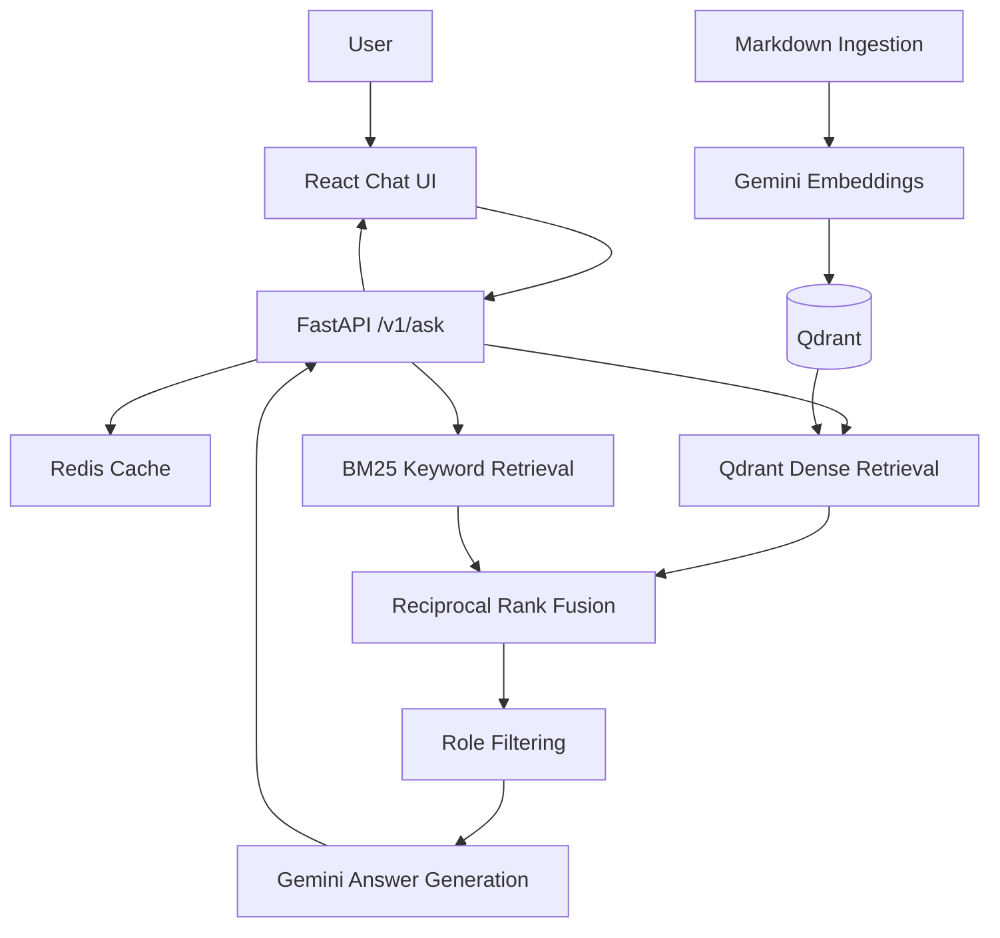

# Meridian Engineering Copilot

A lightweight Retrieval-Augmented Generation (RAG) application that answers engineering questions using documentation, hybrid retrieval, and source citations.

## Features

- FastAPI REST API with Pydantic request validation
- Gemini embeddings and answer generation
- Qdrant vector search
- BM25 keyword retrieval
- Reciprocal Rank Fusion (RRF)
- Role-based document filtering (`engineer`, `admin`)
- Redis response caching
- Abstention when the retrieval score is below a configured threshold
- React chat UI with source citations
- Evaluation script with 15 question cases

## Architecture



## Tech Stack

- Python 3.11
- FastAPI and Pydantic
- Gemini API
- Qdrant
- Redis
- rank_bm25
- React and Vite
- Docker Compose

## Project Structure

```text
meridian-engineering-copilot/
├── app/
│   └── main.py
├── data/
│   ├── admin/
│   │   └── deployment.md
│   └── engineer/
│       ├── fastapi-intro.md
│       └── first-steps.md
├── scripts/
│   ├── ingest.py
│   └── evaluate.py
├── frontend/
│   └── src/
│       ├── App.jsx
│       └── App.css
├── .env
├── .gitignore
├── Dockerfile
├── docker-compose.yml
└── requirements.txt
```

## Prerequisites

- Docker Desktop
- Python 3.11
- Node.js and npm
- A Gemini API key

## Setup

### 1. Configure environment variables

Create a `.env` file in the project root:

```env
GEMINI_API_KEY=your_gemini_api_key
GEMINI_MODEL=gemini-2.5-flash
QDRANT_URL=http://qdrant:6333
REDIS_URL=redis://redis:6379/0
COLLECTION_NAME=meridian_docs
ABSTAIN_THRESHOLD=0.015
```

Never commit `.env` or expose your API key.

### 2. Start the backend services

```bash
docker compose up --build -d
```

### 3. Ingest the documentation

```bash
docker compose exec api python scripts/ingest.py
```

The ingestion script chunks Markdown documents, generates embeddings, and stores vectors with source, title, and role metadata.

### 4. Start the React frontend

In a separate terminal:

```bash
cd frontend
npm install
npm run dev
```

Open the URL printed by Vite, normally `http://localhost:5173`.

### 5. Test the API

Health check:

```bash
curl http://localhost:8000/health
```

Ask a question:

```bash
curl -X POST http://localhost:8000/v1/ask \
  -H "Content-Type: application/json" \
  -d '{"question":"How do I create a FastAPI endpoint?","role":"engineer"}'
```

### 6. Run the evaluation

```bash
docker compose exec api python scripts/evaluate.py
```

## Evaluation Results

Preliminary local run against three Markdown documents:

| Metric | Result |
|---|---:|
| Evaluation questions | 15 |
| Mean Precision@5 | 0.720 |
| Mean retrieval latency | 886.5 ms |

These are initial results, not a statistically robust benchmark. Precision@5 uses expected source files as relevance labels, and latency varies with the environment.

## API

### POST `/v1/ask`

Request:

```json
{
  "question": "How do I create a FastAPI endpoint?",
  "role": "engineer",
  "top_k": 5
}
```

The response includes the generated answer, citations, abstention status, cache status, and latency.

### POST `/v1/retrieve`

Returns the ranked source chunks for retrieval evaluation.

## Limitations

- The role selector is a demonstration filter, not authentication.
- The abstention threshold is heuristic and is not a calibrated confidence probability.
- The evaluation uses source-level relevance labels rather than manually judged chunk relevance.
- Citations identify retrieved documents but do not guarantee every generated claim is supported.
- The corpus currently contains only three Markdown documents.

## Future Improvements

- Add authenticated role enforcement.
- Expand the document corpus.
- Evaluate groundedness and answer correctness.
- Calibrate abstention against labeled examples.
- Add automated tests and production deployment configuration.

## License and Data Attribution

The sample documentation is sourced from the public FastAPI documentation repository:
https://github.com/fastapi/fastapi

Refer to the upstream repository for its applicable license and attribution requirements.
